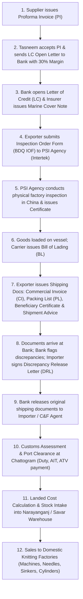

# Tasneem Knitting Industry — Document Analysis & System Specification

Analysis of 9 sample trade, banking, and shipment documents from **Tasneem Knitting Industry** (importer and distributor of circular knitting machines and spare parts: needles, sinkers, cylinders, cams, feeders, belts). This specification provides the exact data dictionaries, formulas, fixed texts, layout structures, and workflows required to build a purchase, import-document, inventory, landed-cost, and sales tracking system.

---

## 1. Document-by-Document Breakdown

### Document 1: `PI NO.HM-06092026.xlsx`
1. **File name & type:** `PI NO.HM-06092026.xlsx` | Excel (`.xlsx`) | Proforma Invoice issued by the foreign machinery supplier to formally quote prices, specifications, and terms to enable L/C opening.
2. **Parties & Timing:**
   - *Filled by:* Exporter / Supplier (`HONGKONG MATILL TRADING COMPANY LIMITED`).
   - *When:* Initial contract agreement stage (dated `2026.09.06`; valid for 30 days).
   - *Received by:* Importer / Buyer (`TASNEEM KNITTING INDUSTRY`), who signs acceptance and submits it to their bank (`NCC Bank PLC`) to open an import L/C.
3. **Exact Field Labels & Column Headers (Original Language: English):**

| Section / Grid Ref | Field Label / Header | Example Value | Description |
|---|---|---|---|
| Header (A1:I3) | Supplier Letterhead | `HONGKONG MATILL TRADING COMPANY LIMITED.` `FLAT/RM F 6/F MEGA CUBE NO.8 WANG KWONG ROAD, KOWLOON , HONGKONG` `Tel: 0086-13430352752` | Supplier fixed name & contact |
| Header (A4:I4) | Title | `PROFORMA INVOICE` | Document type |
| Header (A6:B12) | `TO:` | `TASNEEM KNITTING INDUSTRY` `24/3 AUCKPARA, ASHULIA,SAVAR, DHAKA, BANGLADESH` | Buyer company name & address |
| Header (B9) | `BIN-` / `IRC-` | `BIN- 0066738590112` `IRC-260326112298025` | Buyer statutory VAT & Import codes |
| Header (B10) | `EMAIL-` / `PHONE:` | `EMAIL-MAMUNRGIL@GMAIL.COM` `PHONE: +8801711110516` | Buyer contact details |
| Header (B11) | `LOADING PORT-` | `LOADING PORT-FROM ANY SEAPORT OF CHINA TO CHATTOGRAM, BANGLADESH` | Origin and destination ports |
| Header (B12) | End Use Declaration | `capital machinery for 100% export textile industry` | Duty concession declaration |
| Header (E6:I9) | `PI NO.:` | `HM-06092026` | Proforma invoice identifier |
| Header (E6:I9) | `DATE:` | `2026.09.06` | Invoice date |
| Header (E6:I9) | `PAYMENT:` | `100% LC AT SIGHT` | Payment condition |
| Header (E6:I9) | `PRICE TERM:` | `CFR CHATTOGRAM, BANGLADESH` | Incoterms 2020 price basis |
| Col A (Row 13) | `SL.NO` | `1` | Serial number |
| Col B (Row 13) | `DESCRIPTION OF GOODS ELECTRONICS GOOGDS & OTHERS` | `USED CIRCULAR KNITTING MACHINE WITH STANDARD ACCESSORIES & Cylinder Diameter Exceeding 165 mm Brand: JIN HAR/XIANGYING/XINDA/Various Double Jersey machine Model: 34"72F, 24G+28G+32G.` | Full item description, brand, model, gauge |
| Col C:D (Row 13) | `H.S CODE NO.` | `8447.12.00` | Customs Tariff classification |
| Col E (Row 13) | `QTY PCS/KGS/SET` | `8` | Quantity count |
| Col F (Row 14) | [Unit of Measure] | `SET` | Unit of measure |
| Col G:H (Row 13) | `PER UNIT PRICE USD` | `4250` | Unit price in USD (FOB basis) |
| Col I (Row 13) | `AMOUNT (USD)` | `34000` | Line item total in USD |
| Summary (A16:G16) | `SAY USD$ :` | `THIRTY FIVE THOUSAND SIX HUNDRED ONLY.` | Total amount in words |
| Summary (E18:H18) | `TOTAL AMOUNT FOB, USD =` | `34000` | Subtotal FOB machinery price |
| Summary (E19:H19) | `FREIGHT CHARGE USD =` | `1600` | Ocean freight component |
| Summary (C20:H20) | `TOTAL CFR CHATTOGRAM, BANGLADESH USD =` | `35600` | Total contract value |

4. **Formulas and Calculations:**
   - *Line item amount:* Row 14 `I14` = entered `34000` (Calculation: $\text{Qty } 8 \times \text{Unit Price } 4250 = 34000$).
   - *FOB Subtotal:* Cell `I18` formula: `=I15` (Value = `34000`). In words: FOB Total equals line item sum.
   - *Freight Charge:* Cell `I19` = fixed input `1600`.
   - *CFR Total:* Cell `I20` formula: `=SUM(I18:I19)` (Value = `35600`). In words: CFR Total equals Total FOB Amount + Freight Charge ($34,000 + $1,600 = $35,600$).
   - *Amount in Words:* Hardcoded string in `A16:G16` representing total CFR amount.
5. **Fixed Text:**
   - *Supplier letterhead:* `HONGKONG MATILL TRADING COMPANY LIMITED. / FLAT/RM F 6/F MEGA CUBE NO.8 WANG KWONG ROAD, KOWLOON , HONGKONG / Tel: 0086-13430352752`
   - *Statutory declaration:* `capital machinery for 100% export textile industry`
   - *Terms & Conditions (A22:A28):*
     1. `01. L/C should be irrevocable at sight payment.`
     2. `02. Tolerance Limit : 10% + / - acceptable on Value and Quantity`
     3. `03. Negotiation period : 21 days from the shipment date.`
     4. `04. Partial and Transshipment Allowed.`
     5. `05. L/C Should state that minor discrepancies in the documents are acceptable.`
     6. `06.PI validity:30 days.`
     7. `07.Imported machinery is not more than 10 years old and shall have a minimum economic life of 10 years from the date of shipment"`
   - *Truth declaration (A30:A32):* `Declaration: We declare that this invoice shows the actual price of the goods described and that all particulars are true and correct.`
   - *Bank Details (A33:A37):*
     - `ADVISING BANK NAME: ZHEJIANG CHOUZHOU COMMERCIAL BANK CO., LTD JINHUA BRANCH,BANK ADDRESS: NO.161 BAYI SOUTH STREET,JINHUA,ZHEJIANG CHINA.`
     - `SWIFT BIC : CZCBCN2X`
     - `ACCOUNT NO: NRA15702002010590046836 (for USD only)`
     - `BENEFICIARY BANK: HONGKONG MATILL TRADING COMPANY LIMITED.`
   - *Signatures:*
     - Buyer acceptance (left): Physical stamp `TASNEEM KNITTING INDUSTRY`, signed by `Mamunur Rashid, Proprietor`.
     - Supplier seal (right): Stamp `For and on behalf of HONGKONG MATILL TRADING COMPANY LIMITED (香港麥蒂爾貿易有限公司)` with authorized signature `Matill`.
6. **Layout Notes:**
   - 3 sheets in workbook: `Sheet1` (active document), `Sheet2` and `Sheet3` (blank/unused).
   - Page Setup: Portrait, Scale = 72%, paperSize = 9 (A4).
   - Top header (Rows 1–4), Two-column metadata block (Rows 6–12), Main 9-column tabular grid (Rows 13–15), Words row (Row 16), Terms & Totals side-by-side block (Rows 18–28), Bank & Signatures block (Rows 30–43).
7. **Numbering Patterns:**
   - PI Number: `HM-06092026` (Pattern: `[Supplier Prefix]-[DDMMYYYY]`).
   - HS Code: `8447.12.00` (Circular knitting machines with cylinder diameter exceeding 165 mm).

---

### Document 2: `LC Open Letter -$35600.docx`
1. **File name & type:** `LC Open Letter -$35600.docx` | Word (`.docx`) | Official application letter from the buyer to its bank requesting to open an import Letter of Credit against the Proforma Invoice.
2. **Parties & Timing:**
   - *Filled by:* Importer (`Mamunur Rashid, Proprietor, Tasneem Knitting Industry`).
   - *When:* Immediately after PI acceptance (`06.09.2026`).
   - *Received by:* Bank Manager (`NCC Islamic Banking Gulshan Branch, Dhaka`).
3. **Exact Field Labels & Order (Original Language: English):**

| Field Label / Element | Example Value | Description |
|---|---|---|
| Date | `06.09.2026` | Submission date |
| Addressee | `To` `The Manager` `NCC Islamic Banking Gulshan Branch,` `Dhaka` | Bank name, division, branch, city |
| `Subject:` | `Request for Opening Letter of Credit (L/C) against of PI-HM-06092026 for USD 35,600 with 30% Margin.` | Purpose with PI ref, amount, margin % |
| Salutation | `Dear Sir,` | Formal greeting |
| Body Paragraph 1 | `I would like to request you to kindly open a Letter of Credit (L/C) amounting to USD 35,600 (US Dollars Thirty Five Thousand Six Hundred Only) in favor of our supplier HONGKONG MATILL TRADING COMPANY LIMITED. for import purposes with 30% margin.` | Terms: Amount in figures & words, Beneficiary, 30% cash margin |
| Body Paragraph 2 | `I would be grateful if you would process the L/C opening as per bank rules and necessary formalities at your earliest convenience. I shall comply with all required documentation, margin deposit, charges and other banking formalities accordingly.` | Legal commitment to fees and margin |
| Complimentary Close | `Thank you for your kind cooperation.` `Sincerely,` | Closing |
| Signatory Name | `Mamunur Rashid` | Proprietor name |
| `Account Name:` | `Tasneem Knitting Industry.` | Bank account title |
| `Account Number:` | `7021010002144` | NCC Bank Islamic 13-digit A/C number |
| `Signature:` | [Proprietor Stamp & Signature Image] | Verification stamp & signature |

4. **Formulas and Calculations:**
   - *Margin Requirement:* $\text{Total Value } \$35,600 \times 30\% = \$10,680$ (BDT equivalent blocked from account based on exchange rate).
   - *Amount in Words:* `US Dollars Thirty Five Thousand Six Hundred Only` for USD 35,600.
5. **Fixed Text:**
   - *Pre-printed Letterhead Image (`image1.jpeg`):*
     - Company Name: `TASNEEM KNITTING INDUSTRY`
     - Subtitle: `Circular Knitting & Textile Machine Importer`
     - Address: `Chan Nagor, Plot-594, BSCIC 4-No Road, Idustrial Park, Shashongaon, Enayetnagor, Fatullah, Narayangonj.`
     - Phones: `01711-110516, 01885-507023, 018807-89999`
     - Email: `tasneemknit@gmail.com`
     - Hotline: `Hotline : 01887683333`
     - Left Calligraphy Logo + Right Oval 'T/Y' Emblem with center watermark.
   - Bank branch: `NCC Islamic Banking Gulshan Branch, Dhaka`.
   - Buyer Account Number: `7021010002144`.
6. **Layout Notes:**
   - 1-page Word document printed on official corporate pre-printed/digital letterhead.
   - Orientation: Portrait (A4 size: $11906 \times 16838$ dxa). Margins: 1 inch (1440 dxa).
   - Embedded graphical letterhead background and bottom signature block (`image2.png`).
7. **Numbering Patterns:**
   - File naming: `LC Open Letter -$[Amount].docx` (`LC Open Letter -$35600.docx`).
   - Referenced PI: `PI-HM-06092026`.
   - Bank Account: 13 digits (`7021010002144`).

---

### Document 3: `BDQ IOF新(2).docx`
1. **File name & type:** `BDQ IOF新(2).docx` | Word (`.docx`) | Pre-shipment inspection (PSI) Information Request Form submitted to Intertek for Bangladesh mandatory capital machinery inspection.
2. **Parties & Timing:**
   - *Filled by:* Exporter / Seller (`HONGKONG MATILL TRADING COMPANY LIMITED`, Contact: `Mr. Wu`).
   - *When:* When machinery is ready for inspection in China prior to port containerization (`21.09.2026`).
   - *Received by:* PSI Agency (`Intertek Government & Trade Services`).
3. **Exact Field Labels & Column Headers (Original Language: English):**

| Section | Exact Field Label / Column Header | Example Value | Description |
|---|---|---|---|
| Header | Header Notice & Instructions | `REQUEST FOR INFORMATION NOTICE` `INSTRUCTION: Please complete all fields in print. Omission of information may result in a delayed inspection.` | Mandatory form instruction |
| Table 5 (Row 1) | `Exporter Name` | `HONGKONG MATILL TRADING COMPANY LIMITED.` | Foreign seller |
| Table 5 (Row 2) | `Exporter Address` | `FLAT/RM F 6/F MEGA CUBE NO.8 WANG KWONG ROAD, KOWLOON , HONGKONG` | Seller location |
| Table 5 (Row 3) | `Email Address:` / `Telephone No.:` | `0086-13430352752` | Contact telephone |
| Table 7 (Row 1) | `Location Address:` | `AnySector,MaanStreet,KeqiaoDistrict,ShaoxingCity,ZhejiangProvince` | Factory inspection site |
| Table 7 (Row 2) | `Contact Name:` / `Telephone No.:` | `Mr. Wu` / `15957565333` | Factory floor contact |
| Table 7 (Row 3) | `Goods Availability Date:` / `Proposed Inspection Date:` | `21.09.2026` / `21.09.2026` | Readiness & requested inspection date |
| Table 7 (Row 4) | `Shipment Type:` | `☐ Partial` / `Full Shipment` | Consignment completeness |
| Table 7 (Row 5–6) | `Shipment Mode:` | `By Sea` / `☐ *FCL` / `Specify number of FCLs: LCL ☐ Other` / `☐ By Air` | Transport mode |
| Table 7 (Footnote)| Notice | `*Note: Intertek is required to witness sealing of Full Container Loads - FCLs` | FCL container sealing rule |
| Table 9 (Row 1) | `GOODS INFORMATION` | `YES` / `NO` checkboxes | Inspection eligibility checklist |
| Table 9 (Row 2) | `Is your goods old/used/reconditioned?` | [Checked YES / NO] | Machinery condition flag |
| Table 9 (Row 3) | `Do you have maintenance report if the goods are old/used/reconditioned` | `☐` | Refurbishment proof |
| Table 9 (Row 4) | `Do the exported goods have any brand?` | `☐` | Branded machinery flag |
| Table 9 (Row 5) | `If YES, do you have Brand Register Certificate or Authorization Certificate issued by brand holder indicating the permission of selling above mentioned goods?` | `☐` | Trademark/IP authorization |
| Table 11 (Row 1)| `Payment effected on:` | `exporter` | Entity paying inspection fee |
| Table 11 (Row 2)| `Method of Payment:` | `Bank Transfer` / `☐ Deposit` / `☐ Cheque` / `Specify Cheque No.` | Payment instrument |
| Declaration | `DECLARATION` | `I acknowledge the receipt of Intertek's Notification Letter...` | Liability & security waiver |
| Sign-off | Fields | `Exporter name: ; Position: ; Signature: ; Date: .` | Execution fields |

4. **Formulas and Calculations:** None.
5. **Fixed Text:**
   - Intertek banner: `intertek - Total Quality. Assured.` (`image1.png`).
   - Declaration text: `I acknowledge the receipt of Intertek's Notification Letter, Request for Information Notice and agree to the Terms and Conditions and requirements referenced therein. Additionally I acknowledge that Intertek is not responsible for the security of the consignment subsequent to physical inspection and that this is the responsibility of the importer and/or exporter as specified in their contractual obligations to one another.`
6. **Layout Notes:**
   - 1-page Word document, Portrait orientation.
   - 4 standalone bordered tables representing structural form sections with embedded checkbox characters (`☐`).
7. **Numbering Patterns:**
   - File naming: `BDQ IOF新(2).docx` (`BDQ` = Bangladesh Pre-shipment, `IOF` = Inspection Order Form, `新` = New/Revised, `(2)` = iteration).
   - Dates: `DD.MM.YYYY` (`21.09.2026`).

---

### Document 4: `COMMERCIAL INVOICE 1015- -8MC.docx`
1. **File name & type:** `COMMERCIAL INVOICE 1015- -8MC.docx` | Word (`.docx`) | Commercial Invoice issued by foreign supplier for customs duty assessment, port clearance, and L/C payment settlement.
2. **Parties & Timing:**
   - *Filled by:* Exporter / Seller (`HONGKONG MATILL TRADING COMPANY LIMITED`).
   - *When:* Upon shipment dispatch (`23th Sep 2026`), against LC opened on `07 Sep 2026`.
   - *Received by:* Importer (`TASNEEM KNITTING INDUSTRY`), Negotiating/Issuing Bank (`NCC Bank PLC`), and Bangladesh Customs (Chattogram Port).
3. **Exact Field Labels & Column Headers (Original Language: English):**

| Section / Grid Ref | Exact Field Label / Header | Example Value | Description |
|---|---|---|---|
| Header (Table 2) | Supplier Name & Address | `HONGKONG MATILL TRADING COMPANY LIMITED.` `FLAT/RM F 6/F MEGA CUBE NO.8 WANG KWONG ROAD, KOWLOON , HONGKONG` | Exporter letterhead |
| Header (P4) | `Tel:` | `0086-13430352752` | Phone |
| Title (P6) | Title | `COMMERCIAL INVOICE` | Document type |
| Metadata (P9) | `CI NO:` / `DATE:` | `CI NO:TKI-1015, DATE: 23th Sep 2026` | Commercial invoice ref & date |
| Metadata (P10–12)| Buyer Name & Address | `24/3, AUCKPARA, ASHULIA, SAVAR, DHAKA, BANGLADESH` `POST CODE 1340 , EMAIL: TASNEEMKNIT@GMAIL.COM PHONE: +8801711110516` | Consignee details |
| Metadata (P13–14)| `BIN NO:` / `IRC:` | `BIN NO: 006673859-0112` / `IRC: 260326112298025` | Buyer tax & trade IDs |
| Metadata (P15) | `LC NO:` / `DATE:` | `LC NO: 163026010167 DATE: 2026 Sep 07` | L/C reference & date |
| Metadata (P16–19)| Logistics & Payment Terms | `LOADING PORT- ANY PORT OF CHINA` `PAYMENT: 100% LC AT SIGHT` `DESTINATION - CHATTOGRAM, BANGLADESH` `DELIVERY TERMS CFR CHATTOGRAM BY SEA` | Shipping & payment terms |
| Metadata (P20) | `PI NO:` / `DATE:` | `PI NO: HM-06092026 DATE: 2026.09.06` | Underlying proforma invoice |
| Col 1 (Table 22) | `SL.NO` | `1` | Serial number |
| Col 2 (Table 22) | `DESCRIPTION OF GOODS - CAPITAL MACHINERIES` | `USED CIRCULAR KNITTING MACHINE WITH STANDARD ACCESSORIES & Cylinder Diameter Exceeding 165 mm Brand: JIN HAR/XIANGYING/XINDA/Various Double Jersey machine Model: 34"72F, 24G+28G+32G.` | Full item description |
| Col 3 (Table 22) | `H.S CODE NO.` | `8447.12.00` | HS tariff code |
| Col 4 (Table 22) | `QTY` | `8` (Total: `8`) | Item quantity |
| Col 5 (Table 22) | `UNIT` | `SET` (Total: `SET`) | Unit of measure |
| Col 6 (Table 22) | `N.W. (KGS)` | `17280` (Total: `17280 KGS`) | Total Net Weight in KGS |
| Col 7 (Table 22) | `N.W. (KGS)` *(Typo in doc for G.W.)* | `19200` (Total: `19200 KGS`) | Total Gross Weight in KGS |
| Col 8 (Table 22) | `PER UNIT PRICE USD` | `4250` (Total: `TOTAL`) | Unit price FOB |
| Col 9 (Table 22) | `AMOUNT (USD)` | `34000.00` (Total: `34000.00`) | Line amount FOB |
| Words (P23) | `SAY USD$ :` | `THIRTY FIVE THOUSAND SIX HUNDRED ONLY.` | CFR Amount in words |
| Summary (Table 31)| `TOTAL AMOUNT FOB USD=` | `34000.00` | Total FOB goods value |
| Summary (Table 31)| `FREIGHT CHARGE USD=` | `1600.00` | Ocean freight charge |
| Summary (Table 31)| `TOTAL CFR CHOTTROGRAM` | `35600.00` | Grand total invoice value |

4. **Formulas and Calculations:**
   - *Line Item Amount:* $\text{Qty (8)} \times \text{Unit Price (\$4,250.00)} = \$34,000.00$.
   - *CFR Total:* $\text{Total FOB Amount (\$34,000.00)} + \text{Freight (\$1,600.00)} = \$35,600.00$.
   - *Weight Check:* Net weight = 17,280 KGS (2,160 KGS/set); Gross weight = 19,200 KGS (2,400 KGS/set); Tare = 1,920 KGS.
   - *Words vs Numbers Check:* Words `THIRTY FIVE THOUSAND SIX HUNDRED ONLY` matches CFR Total `$35,600.00`.
5. **Fixed Text:**
   - *Terms & Conditions (Table 33):* Same standard 6 clauses as PI, plus:
     - `.06.Imported machinery is not more than 10 years old and shall have a minimum economic life of 10 years from the date of shipment"`
   - *Declaration (Table 33):* `We declare that this invoice shows the actual price of the goods described and that all particulars are true and correct.`
   - *Banking details (Tables 35–57):* Advising Bank `ZHEJIANG CHOUZHOU COMMERCIAL BANK CO., LTD`, SWIFT `CZCBCN2X`, A/C `NRA15702002010590046836`.
   - *Mandatory Import Clauses (P64–P70):*
     - `COUNTRY/REGION:CHINA`
     - `CERTIFICATE OF ORIGIN ISSUED BY THE COMPETENT AUTHORITY.`
     - `PRE- SHIPMENT INSPECTION FOR QUANTITY , QUALITY, DESCRIPTION, CLASSIFICATION AUDITED BY SGS/ITS/ BV AND PRESENTING INSPECTION REPORT TO THE EFFECT THAT MACHIENS HAVE 10 (TEN) YEARS ECONOMIC LIFE FROM THE DATE OF SHIPMENT.`
6. **Layout Notes:**
   - Multi-page Word document. Portrait orientation ($12240 \times 15840$ dxa). Margins: Top/Bottom 0 dxa, Left 360 dxa, Right 1080 dxa.
   - Notice original document defect: The table header for gross weight was mislabeled as `N.W. (KGS)` (duplicate header for both Col 6 and Col 7).
7. **Numbering Patterns:**
   - Commercial Invoice No.: `TKI-1015` (Pattern: `TKI-[4-digit sequential]`).
   - L/C No.: `163026010167` (12 digits: `1630` = branch, `26` = 2026, `010167` = sequential).

---

### Document 5: `PACKING  LIST-F - 8MC - WS.xlsx`
1. **File name & type:** `PACKING  LIST-F - 8MC - WS.xlsx` | Excel (`.xlsx`) | Final packing list specifying package counts, net/gross weights, and customs compliance declarations for CI TKI-1015.
2. **Parties & Timing:**
   - *Filled by:* Exporter / Supplier (`HONGKONG MATILL TRADING COMPANY LIMITED`).
   - *When:* Accompanying CI TKI-1015 on shipment date (`23 Sep. 2026`).
   - *Received by:* Importer, Bank, C&F Agent, Shipping Line, and Customs Port Authority.
3. **Exact Field Labels & Column Headers (Original Language: English):**

| Section / Grid Ref | Exact Field Label / Header | Example Value | Description |
|---|---|---|---|
| Header (A1:G1) | Supplier Header | `HONGKONG MATILL TRADING COMPANY LIMITED` `FLAT/RM F 6/F MEGA CUBE NO.8 WANG KWONG ROAD, KOWLOON , HONGKONG` `Tel: 0086-13430352752` | Supplier fixed name & contact |
| Title (A3:E3) | Title | `PACKING LIST` | Document type |
| Header (A4:B4) | Buyer / Consignee | `TO: TASNEEM KNITTING INDUSTRY` `24/3, AUCKPARA, ASHULIA, SAVAR, DHAKA, BANGLADESH` `BIN NO: 006673859-0112` `IRC NO: 260326112298025` | Buyer identity & tax registration |
| Header (C4:E4) | Reference Block | `LC NO:163026010167, DATE: 2026 Sep 07` `CI NO.: TKI-1015, DATE: 23 Sep. 2026` `PAYMENT: 100% LC AT SIGHT` `DESTINATION - CHATTOGRAM, BANGLADESH` `DELIVERY TERMS CFR CHATTOGRAM BY SEA` `PI NO.:-HM-06092026, DATE: 06th Sep 2026` | Cross references to LC, CI, PI |
| Header (A5:C5) | Port Route | `FROM ANY SEAPORT OF CHINA TO CHATTOGRAM, BANGLADESH` | Port pair |
| Col A (Row 6) | `SL/NO` | `1` | Serial number |
| Col B (Row 6) | `DESCRIPTION OF GOODS` | `USED CIRCULAR KNITTING MACHINE WITH STANDARD ACCESSORIES & Cylinder Diameter Exceeding 165 mm Brand: JIN HAR/XIANGYING/XINDA/Various Double Jersey machine Model: 34"72F, 24G+28G+32G.` | Complete description |
| Col C (Row 6) | `SET` | `8` | Quantity in sets |
| Col D (Row 6) | `T.N.W (KGS)` | `17280` | Total Net Weight |
| Col E (Row 6) | `T.G.W (KGS)` | `19200` | Total Gross Weight |
| Summary (A8:B8) | `TOTAL` | `8` (Col C), `17280` (Col D), `19200` (Col E) | Summary totals |
| Summary (A9) | Package Summary | `TOTAL : 8 SET & ALL ACCESSORIES` | Total package narrative |
| Footer (A10:E10)| Statutory & Origin Declaration | `IMPORTER IRC NO: 260326112298025, TIN NO:626339507948, BIN NO: 006673859-0112, OF NCC BANK BHABAN BRANCH (NITS), NET WEIGHT OF MERCHANDISE 17280KGS AND GROSS WEIGHT OF MERCHANDISE 19200 KGS AND H.S CODE NO: 8447.12.00`  `WE HEREBY TO CERTIFYING THAT THE MERCHANDISE TO BE OF CHINA ORIGIN AND THE PACKING OF GOODS TO BE PACKED IN EXPORT STANDARD SEA WORTHY PACKING.`  `WE HERE BY TO CERTIFYING THAT THE EFFECT THAT THE GOODS SUPPLIER ARE STRICLY AS PER ABOVE MENTIONED PROFORMA INVOICE NO: -HM-06092026 DATE 2026.09.06` | Legal packing & origin certifications |

4. **Formulas and Calculations:**
   - Hardcoded values in Row 8: Set = `8`, Net Wt = `17280`, Gross Wt = `19200`.
   - Net/Gross reconciliation: $19,200 - 17,280 = 1,920\text{ KGS}$ packaging material weight.
5. **Fixed Text:**
   - Standard export sea-worthy packing certification.
   - Non-preferential country of origin certification (China).
   - PI conformity clause.
6. **Layout Notes:**
   - 1 sheet named `Table 1`.
   - Orientation: Portrait, Scale = 87%, paperSize = 9 (A4).
   - Side-by-side merged top blocks (A4:B4 buyer, C4:E4 LC/CI info). Single merged footer block spanning A10:E10.
7. **Numbering Patterns:**
   - File naming: `PACKING LIST-F - 8MC - WS.xlsx` (`F` = Final, `8MC` = 8 Machines, `WS` = Weight Sheet).
   - Ties together: CI `TKI-1015`, LC `163026010167`, PI `HM-06092026`.

---

### Document 6: `DRL-$35600 - 167.docx`
1. **File name & type:** `DRL-$35600 - 167.docx` | Word (`.docx`) | Discrepancy Release Letter / Waiver issued by the buyer to authorize the bank to accept discrepancy-flagged supplier documents and release payment.
2. **Parties & Timing:**
   - *Filled by:* Importer (`TASNEEM KNITTING INDUSTRY`, Mamunur Rashid).
   - *When:* After bank receives import documents and detects discrepancies (late September / early October 2026).
   - *Received by:* Bank Manager (`NCC Islamic banking Gulshan Branch, Dhaka, Bangladesh`).
3. **Exact Field Labels & Order (Original Language: English):**

| Field Label / Element | Example Value | Description |
|---|---|---|
| Addressee | `To` `The Manager` `NCC Islamic banking Gulshan Branch,` `Dhaka, Bangladesh` | Bank branch addressee |
| `Subject:` | `Subject: Request for Acceptance of Discrepancies and Release of Full Payment and Documents under L/C No. 163026010167` | Purpose and LC reference |
| Salutation | `Dear Sir,` | Formal greeting |
| Opening Paragraph | `With reference to the above-mentioned Letter of Credit, we would like to request you to release below mentioned documents against the accepted documents under the following L/C:` | Operative request |
| Structured List: `LC Date:` | `07-September-2026` | L/C issue date |
| Structured List: `LC No.:` | `163026010167` | L/C number |
| Structured List: `Applicant Name:` | `TASNEEM KNITTING INDUSTRY` | Importer name |
| Structured List: `Currency:` | `USD` | Transaction currency |
| Structured List: `Documents Amount:` | `USD 35600.00` | Full invoice amount |
| Concluding Instruction | `Since the documents with discrepancy have been accepted by us, kindly arrange to release the documents at your earliest convenience.` | Unconditional release order |
| Complimentary Close | `Thanking you for your kind cooperation.` `Yours faithfully,` | Closing |
| Signatory Organization | `TASNEEM KNITTING INDUSTRY` | Company name |
| Signature Block | [Stamp: `TASNEEM KNITTING INDUSTRY`, Signed: `Mamunur Rashid`, `Proprietor`] | Legal authorization |

4. **Formulas and Calculations:**
   - Documents Amount = `USD 35600.00` (must match exact CFR commercial invoice amount to permit 100% foreign exchange negotiation).
5. **Fixed Text:**
   - Official letterhead image (`image1.jpeg`): Same corporate details as Document 2.
   - Bank name: `NCC Islamic banking Gulshan Branch, Dhaka, Bangladesh`.
   - Standard legal waiver text releasing bank from liability for document discrepancies.
6. **Layout Notes:**
   - 1-page Word document, Portrait orientation ($11906 \times 16838$ dxa).
   - Embedded corporate letterhead image (`image1.jpeg`) and proprietor signature image (`image2.png`).
7. **Numbering Patterns:**
   - File name pattern: `DRL-$[Amount] - [LC Last 3 Digits].docx` (`DRL-$35600 - 167.docx`).
   - LC No.: `163026010167` (Last 3 digits: `167`).

---

### Document 7: `DOC-163.xlsx`
1. **File name & type:** `DOC-163.xlsx` | Excel (`.xlsx`) | Multi-sheet synchronized trade workbook containing 3 linked documents for LC No. 163026010163:
   - Sheet 1: `DP` = Detail Packing List
   - Sheet 2: `C` = Beneficiary's Certificate
   - Sheet 3: `A` = Shipment Advice
2. **Parties & Timing:**
   - *Filled by:* Exporter / Supplier (`CBMA HK LIMITED`).
   - *When:* At shipment dispatch (CI date `08th Sep. 2026`, LC date `02th Sep.2026`, BL/ETD `15.SEP.2026`, Advice date `24th Sep 2026`).
   - *Received by:*
     - Sheet `DP`: Customs, Importer, Bank.
     - Sheet `C`: Bank (`NCC Bank PLC`) under LC negotiation terms.
     - Sheet `A`: Insurance Company (`Islami Commercial Insurance PLC`), Bank (`NCC Bank PLC`), and Importer.
3. **Exact Field Labels & Column Headers per Sheet (Original Language: English):**

#### Sheet 1: `DP` (Detail Packing List)
| Grid Ref | Field Label / Header | Example Value | Description |
|---|---|---|---|
| A1:E1 | Supplier Header | `CBMA HK LIMITED ` | Exporter name |
| A2:E2 | Supplier Address | `ADDRESS: RM 1002, 10/F EASEY COMM BUILDING, 253-261 HENNESSY ROAD, WAN CHAIHONGKONG, HONG KONG.` | Exporter address |
| A3:E3 | Document Title | `DETAIL PACKING LIST ` | Document type |
| D4 | `DATE:` | `24th Sep 2026` | Packing list date |
| A5:B5 | `TO:` | `TASNEEM KNITTING INDUSTRY\r\n24/3, AUCKPARA, ASHULIA, SAVAR, DHAKA,BANGLADESH` | Buyer name & address |
| D5 | `CI NO:` | `TKI-1014` | Commercial Invoice number |
| A6 | Tax Numbers | `TIN:626339507948 AND BIN:006673859-0112` | Buyer TIN & BIN |
| D6 | `DATE:` | `08th September 2026` | CI Date |
| D7 | `LC NO.:` | `163026010163` | LC Number |
| D8 | `LC DATE:` | `02th Sep.2026` | LC Date |
| Col A (Row 12) | `SL/NO` | `1` | Serial number |
| Col B (Row 12) | `DESCRIPTION OF GOODS ` | `USED CIRCULAR KNITTING MACHINE WITH\r\nSTANDARD ACCESSORIES & Cylinder Diameter\r\nExceeding 165 mm Brand: XIANGYING/BAISHENG/JIN HAR Double Jersey machine\r\nModel: 34"72F, 24G+28G+32G.` | Item description & brands |
| Col C (Row 12) | `SET` | `8` | Quantity |
| Col D (Row 12) | `T.N.W(KGS)` | `18112` | Total Net Weight |
| Col E (Row 12) | `T.G.W(KGS)` | `18750` | Total Gross Weight |
| Row 14 | `TOTAL` | `8` (Col C), `18112` (Col D), `18750` (Col E) | Totals row |

#### Sheet 2: `C` (Beneficiary's Certificate)
| Grid Ref | Field Label / Header | Example Value | Description |
|---|---|---|---|
| A1:D1 | Supplier Header | `CBMA HK LIMITED ` | Exporter name |
| A2:D2 | Supplier Address | `ADDRESS: RM 1002, 10/F EASEY COMM BUILDING...` | Exporter address |
| A3:D3 | Title | `BENEFICIARY'S CERTIFICATE` | Document title |
| C4 | `DATE:` | `24th Sep- 2026` | Issue date |
| A5:A6 | `TO:` | `TASNEEM KNITTING INDUSTRY\r\n24/3, AUCKPARA, ASHULIA, SAVAR, DHAKA,BANGLADESH` | Buyer details |
| C5 | `CI NO:` | `TKI-1014` | Commercial Invoice ref |
| C6 | `DATE:` | `08th  Sep. 2026` | CI Date |
| A7 | Tax Line | `TIN:626339507948 AND BIN:006673859-0112` | Linked from Sheet DP |
| C7 | `LC NO.:` | `163026010163` | LC Number |
| C8 | `LC DATE:` | `02th Sep.2026` | LC Date |
| A9 | Preamble | `HERE WE CERTIFY THAT: ` | Certification header |
| A10:D10 | Clause A | `A. COUNTRY OF ORIGIN,NAME AND ADDRESS OF THE APPLICANT ALONGWITH APPLICANT'S TIN:626339507948 AND BIN:006673859-0112 HAS BEEN CLEARLY MENTIONED WITH INDELIBLE INK ON THE SURFACE OF AT LEAST 2  PERCENT CARTON/CONTAINER/PACK/BAG/ROLL.` | 2% Indelible ink package marking |
| A11:D11 | Clause B | `B. A FULL SET OF NON NEGOTIABLE SHIPPING DOCUMENTS MUST BE SENT DIRECTLY TO THE APPLICANT BY EMAIL WITHIN 5(FIVE) WORKING DAYS AFTER SHIPMENT AND ALSO TO EMAIL ID: IB.GULSHAN@NCCBANK. COM.BD AND COPY TO EMAIL ID: NITS@NCCBANK.COM.BD.` | 5-day document dispatch by email |
| A12:D12 | Clause C | `C. THE LIFE OF CONCERNED MACHINERY AND DECLARING THE CONCERNED MACHINERY ARE HAZARDLESS FOR PUBLIC LIFE AND ARE ENVIRONMENT FRIENDLY.` | Environmental & safety certification |
| A13:D13 | Clause D | `D. GOODS FROM ISRAEL OR GOODS PRODUCED IN THAT COUNTRY AND ALSO GOODS CARRIED IN THE FLAG VESSELS OF THAT COUNTRY IS STRICTLY PROHIBITED.` | Israel trade boycott declaration |

#### Sheet 3: `A` (Shipment Advice)
| Grid Ref | Field Label / Header | Example Value | Description |
|---|---|---|---|
| A1:C1 | Supplier Header | Linked formula: `='C'!A1:D1` | Dynamic supplier name |
| A2:C2 | Supplier Address | Linked formula: `='C'!A2:D2` | Dynamic supplier address |
| A3:C3 | Title | `SHIPMENT ADVICE ` | Document title |
| A4 | `TO:` | Linked formula: `='C'!A5` | Dynamic buyer name & address |
| B4 | `DATE:` | Linked formula: `='C'!C4` | Dynamic advice date (`24th Sep- 2026`) |
| A6 | Distribution 1 (Insurer) | `TO ISLAMI COMMERCIAL INSURANCE PLC, HEAD OFFICE,CITY CENTER(LEVEL-16),90/1,MOTIJHEEL C/A,DHAKA-1000,BANGLADESH BY (EMAIL ID:ICICLBD(AT)GMAIL.COM) ` | Insurance company copy |
| A8 | Distribution 2 (Bank) | `TO: NATIONAL CREDIT AND COMMERCE BANK PLC, NCC BANK BHABAN BRANCH(NITS),  DHAKA, BANGLADESH (BIN-000483356-0202)(EMAIL:NITS(AT)NCCBANK.COM.BD) ` | Bank copy |
| A10 | Insurance Reference | `COVER NOTE NO.ICI/BAB/MC-0118/09/2026 DATED 01/09/2026` | Marine cover note number & date |
| A11 | `CI NO:` | Linked formula: `='C'!C5` (`CI NO: TKI-1014`) | CI reference |
| A12 | `DATE:` | Linked formula: `='C'!C6` (`DATE: 08th  Sep. 2026`) | CI date |
| A13 | `LC NO.:` | Linked formula: `='C'!C7` (`LC NO.:163026010163`) | LC number |
| A14 | `LC DATE:` | Linked formula: `='C'!C8` (`LC DATE: 02th Sep.2026`) | LC date |
| A15 | `NAME OF VESSEL:` | `MAERSK HAI PHONG` | Vessel name |
| A16 | `ETD OF THE VESSEL:` | `15.SEP.2026` | Estimated departure date |
| A17 | `BILL OF LADING NO.:`| `802656191` | Ocean B/L number |
| A18 | `BILL DATE:` | `15th SEP. 2026` | Ocean B/L date |
| A19 | `NAME OF PORT OF SHIPMENT:`| `NINGBO, CHINA` | Loading port |
| A20 | `PORT OF DISCHARGE:` | `CHATTOGRAM ,BANGLADESH` | Destination port |

4. **Formulas and Calculations:**
   - *Packing List Totals (Sheet DP):*
     - Total Net Weight: Cell `D14` formula: `=SUM(D13)` -> Result: `18112`
     - Total Gross Weight: Cell `E14` formula: `=SUM(E13)` -> Result: `18750`
   - *Cross-sheet Dynamic References:*
     - Sheet `C`, Cell `A7` formula: `=DP!A6` (Pulls buyer TIN and BIN from Packing List).
     - Sheet `A`, Cell `A1` formula: `='C'!A1:D1` (Pulls Supplier Name).
     - Sheet `A`, Cell `A2` formula: `='C'!A2:D2` (Pulls Supplier Address).
     - Sheet `A`, Cell `A4` formula: `='C'!A5` (Pulls Buyer details).
     - Sheet `A`, Cell `B4` formula: `='C'!C4` (Pulls Advice Date).
     - Sheet `A`, Cell `A11` formula: `='C'!C5` (Pulls CI Number).
     - Sheet `A`, Cell `A12` formula: `='C'!C6` (Pulls CI Date).
     - Sheet `A`, Cell `A13` formula: `='C'!C7` (Pulls LC Number).
     - Sheet `A`, Cell `A14` formula: `='C'!C8` (Pulls LC Date).
5. **Fixed Text:**
   - Supplier: `CBMA HK LIMITED, RM 1002, 10/F EASEY COMM BUILDING, 253-261 HENNESSY ROAD, WAN CHAIHONGKONG, HONG KONG.`
   - Bank distribution: `NATIONAL CREDIT AND COMMERCE BANK PLC, NCC BANK BHABAN BRANCH(NITS), DHAKA, BANGLADESH (BIN-000483356-0202) (EMAIL:NITS@NCCBANK.COM.BD)`.
   - Bank branch email: `IB.GULSHAN@NCCBANK.COM.BD`.
   - Insurer distribution: `ISLAMI COMMERCIAL INSURANCE PLC, HEAD OFFICE, CITY CENTER(LEVEL-16), 90/1, MOTIJHEEL C/A, DHAKA-1000, BANGLADESH (EMAIL:ICICLBD@GMAIL.COM)`.
   - Clauses: 2% packaging marking, 5-day email dispatch, environmental non-hazardous declaration, Israel trade ban.
6. **Layout Notes:**
   - Workbook with 3 visible sheets designed to print on A4 Portrait.
   - Master data entry pattern: Editing Sheet `DP` and Sheet `C` automatically updates Sheet `A`.
7. **Numbering Patterns:**
   - File naming: `DOC-163.xlsx` (Named after last 3 digits of LC No. `163026010163`).
   - CI No.: `TKI-1014`
   - LC No.: `163026010163`
   - Ocean B/L No.: `802656191` (9 digits).
   - Insurance Cover Note: `ICI/BAB/MC-0118/09/2026` (Pattern: `[Company]/[Branch]/MC-[Sequential]/[MM]/[YYYY]`).

---

### Document 8: `Beneficiary_Certificate_Tasneem.docx`
1. **File name & type:** `Beneficiary_Certificate_Tasneem.docx` | Word (`.docx`) | Standalone Beneficiary's Certificate issued by foreign supplier CBMA HK LIMITED for an earlier parallel shipment under LC No. 163026010117.
2. **Parties & Timing:**
   - *Filled by:* Exporter / Supplier (`CBMA HK LIMITED`).
   - *When:* Shipment dispatch stage (accompanying shipment under LC dated `29 Jun 2026`, PI dated `2026.06.16`).
   - *Received by:* Bank (`NCC Bank PLC`) and Importer.
3. **Exact Field Labels & Order (Original Language: English):**

| Element / Paragraph | Exact Content / Field Label | Example Value | Description |
|---|---|---|---|
| P1–4 | Supplier Header | `CBMA HK LIMITED` `ADDRESS: RM 1002, 10/F EASEY COMM BUILDING,` `253-261 HENNESSY ROAD, WAN CHAIHONGKONG,` `HONG KONG. Tel:+8618762653301 ,Email: alix@sxjinzhe.com` | Supplier contact |
| P5 | Title | `BENEFICIARY'S CERTIFICATE` | Document title |
| P7 | `TO:` | `TASNEEM KNITTING INDUSTRY 24/3, AUCKPARA, ASHULIA, SAVAR, DHAKA, BANGLADESH` `BIN NO: 006673859-0112` | Buyer name, address, BIN |
| P9 | Preamble | `WE CERTIFY THAT,` | Attestation header |
| P10 | Clause A | `A) EACH SET OF NON-NEGOTIABLE DOCUMENTS INCLUDE DETAILED PACKING LIST HAS BEEN DISPATCHED TO THE APPLICANT BY COURIER OR THROUGH EMAIL WITHIN 05(FIVE) DAYS AFTER SHIPMENT BY COURIER/EMAIL` | 5-day dispatch clause |
| P11 | Clause B | `B) THE QUANTITY, QUALITY, CLASSIFICATION, DESCRIPTION, SPECIFICATION AND WEIGHT OF THE GOODS ARE FULLY AS PER L/C TERMS.` | Compliance with LC |
| P12 | Clause C | `C) COUNTRY OF ORIGIN HAS BEEN MENTIONED CLEARLY ON THE PACKAGES OF GOODS/POTS/BOX/CONTAINER ETC.` | Origin marking |
| P13 | Clause D | `D) APPLICANT'S NAME, ADDRESS, TIN NO: 626339507948, BIN NO: 006673859-0112 HAS BEEN INSCRIBED OR PRINTED IN INDELIBLE INK ON AT LEAST 2% OF THE LARGEST PACKET/COVER/TINNED PACKAGE/SACK PACK/WOODEN BOX/CASE/ROLL/OTHER PACKET CONTAINING THE IMPORTED GOODS.` | Indelible ink marking |
| P14 | Clause E | `E) THE GOODS ARE USED MACHINE` | Used machine status |
| P16 | `DESCRIPTION OF GOODS:` | `USED CIRCULAR KNITTING MACHINE WITH STANDARD ACCESSORIES & Cylinder Diameter Exceeding 165 mm.` | Goods description |
| P17 | Weights | `TOTAL NET WEIGHT: 20960 KGS AND TOTAL GROSS WEIGHT: 22008 KGS` | Weight figures |
| P18 | Delivery & Proforma Reference | `CFR CHATTOGRAM SEAPORT BANGLADESH (INCOTERMS 2020) AS PER PROFORMA INVOICE NO. CBMA-HK-16062026 DATE: 2026.06.16 OF THE BENEFICIARY. THE PRICE, QUALITY, QUANTITY, CLASSIFICATION, DESCRIPTION, SPECIFICATION AND ALL OTHER DETAILS OF THE GOODS MUST BE IN ACCORDANCE WITH THE ABOVE PROFORMA INVOICE.` | Price term & PI ref |
| P19 | Statutory & Banking Details | `IRC NO. 260326112298025, TIN NUMBER: 626339507948, BIN NO. 006673859-0112, AND LC NUMBER 163026010117 DATE: 29 Jun 2026  BIN NO. 000483356-0202 OF NATIONAL CREDIT AND COMMERCE BANK PLC, NCC BANK BHABAN BRANCH (NITS), DHAKA BD BANGLADESH` | Full statutory audit line |
| P20 | `COUNTRY OF ORIGIN:` | `CHINA` | Country of origin |

4. **Formulas and Calculations:** None (Certification). Stated weights: NW = 20,960 KGS, GW = 22,008 KGS, Tare = 1,048 KGS.
5. **Fixed Text:**
   - Supplier Contact: `Tel:+8618762653301 ,Email: alix@sxjinzhe.com`.
   - Five mandatory certification clauses (A through E).
   - Bank branch BIN: `BIN NO. 000483356-0202`.
6. **Layout Notes:**
   - 1-page Word document, Portrait ($12240 \times 15840$ dxa), 1-inch margins.
   - Text paragraphs formatted as formal legal certificate.
7. **Numbering Patterns:**
   - PI Number: `CBMA-HK-16062026` (Pattern: `[Supplier]-[Branch]-[DDMMYYYY]`).
   - LC Number: `163026010117` (Ends in `117`).

---

### Document 9: `shipment_advice.docx`
1. **File name & type:** `shipment_advice.docx` | Word (`.docx`) | Shipment Advice letter issued by supplier CBMA HK LIMITED notifying bank, insurer, and buyer of container loading, carrier, and marine insurance under LC No. 163026010117.
2. **Parties & Timing:**
   - *Filled by:* Exporter / Supplier (`CBMA HK LIMITED`).
   - *When:* Immediately after loading container onto vessel.
   - *Received by:* Bank (`National Credit and Commerce Bank PLC`), Marine Insurer, and Importer.
3. **Exact Field Labels & Order (Original Language: English):**

| Element / Paragraph | Exact Content / Field Label | Example Value | Description |
|---|---|---|---|
| P1–4 | Supplier Header | `CBMA HK LIMITED` `ADDRESS: RM 1002, 10/F EASEY COMM BUILDING,` `253-261 HENNESSY ROAD, WAN CHAIHONGKONG,` `HONG KONG. Tel:+8618762653301 ,Email: alix@sxjinzhe.com` | Supplier contact |
| P5 | Title | `SHIPMENT ADVICE` | Document title |
| P6 | `TO:` | `NATIONAL CREDIT AND COMMERCE BANK PLC` `BIN: 000483356-0202` `NCC BANK BHABAN BRANCH(NITS), DHAKA BD BANGLADESH.` | Addressee bank & BIN |
| P7 | Description & Weights | `DESCRIPTION OF GOODS: USED CIRCULAR KNITTING MACHINE WITH STANDARD ACCESSORIES & Cylinder Diameter Exceeding 165 mm.` `TOTAL NET WEIGHT: 20960 KGS AND TOTAL GROSS WEIGHT: 22008 KGS AND TOTAL PACKAGES: 8 SETS  WITH  ALL STANDER  ACCESSORIES` | Item, weight & package count |
| P8 | Contract Terms | `CFR CHATTOGRAM SEAPORT, BANGLADESH (INCOTERMS 2020) AS PER PROFORMA INVOICE NO. CBMA-HK-16062026, DATE: 2026.06.16 OF THE BENEFICIARY. THE PRICE, QUALITY, QUANTITY, CLASSIFICATION, DESCRIPTION, SPECIFICATION AND ALL OTHER DETAILS OF THE GOODS MUST BE IN ACCORDANCE WITH THE ABOVE PROFORMA INVOICE.` | Price basis & PI ref |
| P9 | Statutory IDs | `IRC NUMBER 260326112298025, TIN NUMBER 626339507948, BIN NUMBER 006673859-0112 AND LC NUMBER 163026010117 DATE: 29 Jun 2026 BIN NO. 000483356-0202 OF NATIONAL CREDIT AND COMMERCE BANK PLC, NCC BANK BHABAN BRANCH(NITS), DHAKA BD BANGLADESH.` | Full audit line |
| P10 | `COUNTRY OF ORIGIN:` | `CHINA` | Country of origin |
| P11 | Logistics Details | `CONTAINER NO. MRSU7329355 SEAL NO. ML-CN6255248 TOTAL NET WEIGHT: 20960KGS AND TOTAL GROSS WEIGHT: 22008 KGS AND TOTAL PACKAGES: 8 SET WITH  ALL STANDER  ACCESSORIES AND TOTAL CBM 68 CBM.` | Container No, Seal No, CBM |
| P12 | Origin Certification | `WE HEREBY CERTIFY THAT THE MERCHANDISE IS CHINA ORIGIN.` | Origin certification |
| P13 | `PORT OF LOADING:` | `FROM ANY SEAPORT OF CHINA` | Loading port |
| P14 | Discharge & Carrier | `PORT OF DISCHARGE: CHATTOGRAM SEAPORT, BANGLADESH` `PLACE OF DELIVERY: CHATTOGRAM SEAPORT, BANGLADESH` `SHIPMENT DATE:` [Blank in template] `ETA DESTINATION PORT:` [Blank in template] `THE NAME OF CARRIER: MAERSK` | Route, delivery place, shipping carrier |
| P15 | Re-certification | `WE HEREBY CERTIFY THAT THE GOODS ARE OF CHINA ORIGIN.` | Origin attestation |
| P16 | Insurance Reference | `QUOTING INSURANCE COVER NOTE NO: GIL/HOCB/MC-                                     DTD.` | Template placeholder for marine cover note |

4. **Formulas and Calculations:**
   - Volume: `68 CBM` for 8 sets ($\approx 8.5\text{ CBM}$ per machine).
   - Net Weight = 20,960 KGS ($\approx 2,620\text{ KGS}$ per machine).
   - Gross Weight = 22,008 KGS ($\approx 2,751\text{ KGS}$ per machine).
5. **Fixed Text:**
   - Bank branch: `NATIONAL CREDIT AND COMMERCE BANK PLC, NCC BANK BHABAN BRANCH(NITS), DHAKA BD BANGLADESH (BIN: 000483356-0202)`.
   - Buyer IRC, TIN, BIN.
   - Carrier: `MAERSK`.
   - Insurance Cover Note prefix: `GIL/HOCB/MC-` (Global Insurance / Green Delta Insurance).
6. **Layout Notes:**
   - 1-page Word document, Portrait orientation ($12240 \times 15840$ dxa). Margins: Left/Right 1.25 in (1800 dxa), Top/Bottom 1 in.
7. **Numbering Patterns:**
   - Container No.: `MRSU7329355` (4-letter Maersk owner code `MRSU` + 7 digits).
   - Seal No.: `ML-CN6255248` (`ML-CN` = Maersk Line China + 7 digits).
   - LC No.: `163026010117`.

---

## 2. Shared Data Dictionary

These master entity fields appear across multiple documents and should be defined once in the database:

| Entity | Field Name | Type | Appearances in Sample Documents | Primary Source of Truth |
|---|---|---|---|---|
| **Importer (Self)** | Company Name | String | All 9 documents (`TASNEEM KNITTING INDUSTRY`) | Company Profile Settings |
| | Registered Address | Text | All documents (`24/3, AUCKPARA, ASHULIA, SAVAR, DHAKA, BANGLADESH`, Post Code `1340`) | Company Profile Settings |
| | Operational/Factory Address | Text | Doc 2, Doc 6 Letterhead (`Chan Nagor, Plot-594, BSCIC 4-No Road, Idustrial Park, Shashongaon, Enayetnagor, Fatullah, Narayangonj`) | Company Profile Settings |
| | Proprietor Name | String | Doc 1, Doc 2, Doc 6 (`Mamunur Rashid`) | User / Signatory Table |
| | BIN Number | String | All documents (`006673859-0112`) | Company Tax Profile |
| | TIN Number | String | Doc 1, 4, 5, 7, 8, 9 (`626339507948`) | Company Tax Profile |
| | IRC Number | String | Doc 1, 4, 5, 7, 8, 9 (`260326112298025`) | Trade License Profile |
| | Phone / Hotline | String | All documents (`01711-110516`, `01887683333`) | Company Profile Settings |
| | Email | String | All documents (`tasneemknit@gmail.com`, `mamunrgil@gmail.com`) | Company Profile Settings |
| | Bank Account Number | String | Doc 2 (`7021010002144` at NCC Islamic Banking Gulshan) | Bank Accounts Master |
| **Suppliers** | Supplier Name | String | Doc 1, 2, 3, 4, 5, 6 (`HONGKONG MATILL TRADING COMPANY LIMITED`) Doc 7, 8, 9 (`CBMA HK LIMITED`) | Supplier Master |
| | Supplier Address | Text | Doc 1, 3, 4, 5 (Kowloon, HK); Doc 7, 8, 9 (Hennessy Road, HK) | Supplier Master |
| | Supplier Phone / Email | String | `0086-13430352752` / `+8618762653301`, `alix@sxjinzhe.com` | Supplier Master |
| | Advising Bank Name & Address | Text | Doc 1, Doc 4 (`ZHEJIANG CHOUZHOU COMMERCIAL BANK CO., LTD, JINHUA BRANCH`) | Supplier Bank Profile |
| | Advising Bank SWIFT | String | Doc 1, Doc 4 (`CZCBCN2X`) | Supplier Bank Profile |
| | Supplier Account No. | String | Doc 1, Doc 4 (`NRA15702002010590046836`) | Supplier Bank Profile |
| **Banking** | Issuing Bank & Branch | String | Doc 2, Doc 6 (`NCC Islamic Banking Gulshan Branch, Dhaka`) | Bank Branch Master |
| | Bank Trade Operations (NITS) | String | Doc 1, 4, 5, 7, 8, 9 (`NCC BANK BHABAN BRANCH(NITS)`) | Bank Branch Master |
| | Bank BIN | String | Doc 7, 8, 9 (`000483356-0202`) | Bank Master |
| **Shipment / LC** | L/C Number | String | Doc 4, 5, 6 (`163026010167`) Doc 7 (`163026010163`) Doc 8, 9 (`163026010117`) | LC / Import File Master |
| | L/C Issue Date | Date | Doc 4, 5, 6 (`2026-09-07`), Doc 7 (`2026-09-02`), Doc 8, 9 (`2026-06-29`) | LC / Import File Master |
| | PI Number & Date | String / Date | Doc 1, 2, 4, 5 (`HM-06092026` / `2026.09.06`) Doc 8, 9 (`CBMA-HK-16062026` / `2026.06.16`) | Purchase Order / PI Record |
| | Commercial Invoice No & Date | String / Date | Doc 4, 5 (`TKI-1015` / `2026-09-23`) Doc 7 (`TKI-1014` / `2026-09-08`) | Commercial Invoice Record |
| | Delivery Terms | String | All documents (`CFR CHATTOGRAM BY SEA`, Incoterms 2020) | Shipment Record |
| | Loading & Discharge Ports | String | `ANY SEAPORT OF CHINA` to `CHATTOGRAM, BANGLADESH` | Shipment Record |
| | Carrier / Vessel | String | Doc 7 (`MAERSK HAI PHONG`), Doc 9 (`MAERSK`) | Shipment Tracking |
| | Bill of Lading (BL) No & Date | String / Date | Doc 7 (`802656191` / `15th SEP. 2026`) | Shipment Tracking |
| | Container & Seal Numbers | String | Doc 9 (`MRSU7329355` / `ML-CN6255248`) | Container Record |
| | Marine Insurance Cover Note | String / Date | Doc 7 (`ICI/BAB/MC-0118/09/2026` / `01/09/2026`) Doc 9 (`GIL/HOCB/MC-`) | Insurance Record |
| **Products** | Item Name & Category | String | `USED CIRCULAR KNITTING MACHINE WITH STANDARD ACCESSORIES` | Item Master (Capital Machinery) |
| | HS Code | String | `8447.12.00` | Item Master |
| | Brand(s) | String | `JIN HAR`, `XIANGYING`, `XINDA`, `BAISHENG` | Item Master / Brand Master |
| | Technical Specifications | Text | `Double Jersey machine`, `Model: 34"72F, 24G+28G+32G`, Cylinder Diameter Exceeding 165 mm | Item Specification Master |
| | Quantity & Unit | Integer / String| `8` / `SET` | Transaction Line Item |
| | Weights (Net / Gross / Tare) | Decimal (KGS) | Doc 4, 5: `17,280` NW / `19,200` GW Doc 7: `18,112` NW / `18,750` GW Doc 8, 9: `20,960` NW / `22,008` GW | Shipment Packing Details |
| | Unit Price (FOB) & Currency | Decimal / Code | `$4,250.00` / `USD` | Transaction Line Item |
| | Freight Charge | Decimal | `$1,600.00` | Shipment Cost Component |
| | Total CFR Amount | Decimal | `$35,600.00` | Transaction Grand Total |

---

## 3. Document Lifecycle Flow

### Detailed Sequential Steps:
1. **Quotation & Deal Confirmation (Day 0):** Foreign supplier issues Excel Proforma Invoice (`PI NO.HM-06092026.xlsx`) specifying 8 sets used circular knitting machines at \$4,250/set FOB (\$34,000) + \$1,600 ocean freight = \$35,600 CFR Chattogram.
2. **Insurance & L/C Application (Day 1–3):** Importer secures marine insurance cover note from Islami Commercial Insurance PLC (`ICI/BAB/MC-0118/09/2026`), drafts the LC Opening Request Letter (`LC Open Letter -$35600.docx`) on letterhead, deposits 30% cash margin (\$10,680 equivalent in BDT), and submits it to NCC Islamic Banking Gulshan Branch.
3. **L/C Issuance & Advising (Day 4–7):** NCC Bank issues irrevocable L/C at sight (`163026010167`) transmitted via SWIFT to advising bank `Zhejiang Chouzhou Commercial Bank` in China.
4. **Pre-Shipment Inspection (PSI) Booking (Day 15–20):** Mandatory for capital machinery under Bangladesh Import Policy Order. Supplier fills out `BDQ IOF新(2).docx` for Intertek in Shaoxing, Zhejiang, confirming goods readiness on 21.09.2026. Intertek inspects that machines have $\ge 10$ years residual economic life and are $\le 10$ years old, then issues PSI inspection certificate.
5. **Vessel Booking & Loading (Day 20–22):** Goods containerized (e.g. 8 sets in FCL container `MRSU7329355`, 68 CBM, carrier Maersk). Carrier issues Bill of Lading (`802656191`).
6. **Shipping Documentation Generation (Day 23–24):** Supplier generates matching export set:
   - Commercial Invoice (`COMMERCIAL INVOICE 1015- -8MC.docx` / CI No. `TKI-1015`)
   - Packing List (`PACKING  LIST-F - 8MC - WS.xlsx`)
   - Beneficiary's Certificate (`Beneficiary_Certificate_Tasneem.docx` or `DOC-163.xlsx` Sheet `C`)
   - Shipment Advice (`shipment_advice.docx` or `DOC-163.xlsx` Sheet `A`)
   Supplier dispatches non-negotiable copies via email within 5 days to applicant and NCC Bank (`nits@nccbank.com.bd`).
7. **Document Negotiation & Discrepancy Clearance (Day 25–35):** Original documents sent bank-to-bank. When discrepancies are noted, NCC Bank requests waiver; Tasneem issues the Discrepancy Release Letter (`DRL-$35600 - 167.docx`). Bank settles payment with supplier and releases original B/L and invoice to Tasneem.
8. **Port Customs Clearance & Landed Costing (Day 35–45):** C&F agent files Bill of Entry at Chattogram Customs under HS code `8447.12.00`. Customs assesses concessionary duty for capital machinery (1% CD for 100% export textile industry). Port demurrage, C&F fees, inland haulage to Narayanganj/Savar factory are paid.
9. **Stock Intake & Sales Operations:** Machines unboxed, serial numbers recorded, placed into inventory. Spare parts (needles, sinkers, cylinders, cams, feeders, belts) are cataloged. Machines and parts sold to local textile mills on credit or cash with delivery challans and sales invoices.

---

## 4. Reports the Owner Needs

To run this business efficiently, the software must provide 6 core operational and financial reports:

### Report 1: Daily Cash & Bank Position Report
*Purpose:* Tracks daily cash inflows, customer collections, bank balances across accounts, and margin deposits held by banks.
- **Columns:**
  1. `Date`
  2. `Account / Cash Point Name` (e.g., NCC Bank Islamic Gulshan `7021010002144`, Cash in Hand)
  3. `Opening Balance (BDT)`
  4. `Collections / Inflow (BDT)` (Customer payments, cash sales)
  5. `Payments / Outflow (BDT)` (Supplier deposits, freight, local expenses)
  6. `LC Margins Blocked (BDT)`
  7. `Closing Balance (BDT)`

### Report 2: LC Status & Shipment Tracking Pipeline
*Purpose:* Real-time tracking of active import files from PI to port arrival.
- **Columns:**
  1. `LC Number` (e.g., `163026010167`)
  2. `LC Issue Date`
  3. `Supplier Name` (`HONGKONG MATILL TRADING` / `CBMA HK`)
  4. `PI Ref & Date` (`HM-06092026`)
  5. `Items & Qty` (`8 Sets Circular Knitting Machines`)
  6. `LC Value (USD)` (`$35,600.00`)
  7. `Margin Deposited (%)` (`30%`)
  8. `Margin Amount (BDT)`
  9. `Commercial Invoice No & Date` (`TKI-1015` / `2026-09-23`)
  10. `Bill of Lading (BL) No & Date`
  11. `Container No. & Seal No.` (`MRSU7329355`)
  12. `Carrier / Vessel` (`MAERSK`)
  13. `ETD Origin` & `ETA Chattogram`
  14. `Document Status` (`Awaiting Docs` / `Discrepancy Pending` / `Released`)
  15. `Current Stage` (`LC Opened` $\rightarrow$ `Under Inspection` $\rightarrow$ `On Vessel` $\rightarrow$ `Port Clearance` $\rightarrow$ `Cleared`)

### Report 3: Shipment Landed Cost & Margin Worksheet
*Purpose:* Computes the true landed unit cost in BDT for imported machines to set selling prices and ensure profitability.
- **Columns / Calculation Structure:**
  1. `LC & Invoice Number`
  2. `FOB Value (USD)`
  3. `Ocean Freight (USD)`
  4. `Total CFR Value (USD)`
  5. `Bank Settlement Exchange Rate (BDT/USD)` (e.g., 122.00)
  6. `CFR Value in BDT` ($=\text{CFR USD} \times \text{Rate}$)
  7. `Bank Charges, LC Commission, SWIFT fees (BDT)`
  8. `Marine Insurance Premium (BDT)`
  9. `Customs Duty (CD 1%), AIT, ATV, RD, Regulatory Fees (BDT)`
  10. `Chattogram Port & Shipping Line Demurrage / Handling (BDT)`
  11. `C&F Agent Commission & Clearing Expenses (BDT)`
  12. `Inland Haulage / Trucking to Warehouse (BDT)`
  13. `Pre-Shipment Inspection (Intertek) Fee (BDT)`
  14. `Total Landed Cost (BDT)` ($=\sum \text{Lines } 6 \text{ to } 13$)
  15. `Total Quantity Received (Sets)` (`8`)
  16. `Landed Cost Per Unit (BDT/Set)` ($=\text{Total Landed Cost} / \text{Quantity}$)

### Report 4: Machine & Spare Parts Inventory / Stock Ledger
*Purpose:* Real-time warehouse balance for capital machinery and high-velocity spare parts (needles, sinkers, cylinders, cams, feeders, belts).
- **Columns:**
  1. `Item Code / SKU`
  2. `Item Category` (`Capital Machinery` / `Needles` / `Sinkers` / `Cylinders` / `Cams` / `Feeders` / `Belts`)
  3. `Item Description, Brand & Spec` (e.g., `34" 72F 24G+28G+32G Double Jersey`)
  4. `Warehouse Location` (`Narayanganj BSCIC` / `Ashulia Savar`)
  5. `Unit of Measure` (`Set` / `Pcs` / `Box`)
  6. `Opening Stock Qty`
  7. `Purchase / Import Received Qty`
  8. `Sold / Delivered Qty`
  9. `Closing Stock Balance Qty` ($=\text{Opening} + \text{Received} - \text{Sold}$)
  10. `Average Landed Cost (BDT)`
  11. `Total Inventory Valuation (BDT)` ($=\text{Closing Stock Qty} \times \text{Average Landed Cost}$)

### Report 5: Monthly Sales & Customer Receivables (Due) Report
*Purpose:* Tracks sales invoices, cash collections, and outstanding market credit given to textile/knitting factories.
- **Columns:**
  1. `Invoice / Memo Date`
  2. `Sales Invoice / Delivery Challan No.`
  3. `Customer Name & Factory Address`
  4. `Contact Phone`
  5. `Items Sold & Serial Numbers`
  6. `Total Sale Amount (BDT)`
  7. `Advance / Cash Received (BDT)`
  8. `Due / Receivable Balance (BDT)` ($=\text{Total Sale Amount} - \text{Received}$)
  9. `Due Date / Credit Terms (Days)`
  10. `Overdue Aging Bracket` (`Current`, `1-30 Days`, `31-60 Days`, `90+ Days`)

### Report 6: Shipment Advice & Insurance Declaration Register
*Purpose:* Statutory record of all shipment advice notices lodged with marine insurance companies and banks to maintain insurance validity under transit.
- **Columns:**
  1. `Advice Date`
  2. `LC Number & Date`
  3. `Insurance Company Name`
  4. `Cover Note / Policy Number & Date`
  5. `Commercial Invoice No & Value (USD)`
  6. `Vessel Name & B/L No / Date`
  7. `Port of Loading & Port of Discharge`
  8. `Container / Seal No.`
  9. `Net / Gross Weight (KGS) & CBM`
  10. `Bank Intimation Date & Proof of Email Dispatch`

---

## 5. Unclear Items & Technical Discrepancies

The following items are missing, contradictory, or irregular across the physical sample files and require developer handling:

1. **Two Different Addresses for Tasneem Knitting Industry:**
   - *Operational / Letterhead Address:* `Chan Nagor, Plot-594, BSCIC 4-No Road, Idustrial Park, Shashongaon, Enayetnagor, Fatullah, Narayangonj` (with typo `Idustrial` in pre-printed letterhead).
   - *Registered Trade / Import Address:* `24/3, AUCKPARA, ASHULIA, SAVAR, DHAKA, BANGLADESH` (Post Code 1340).
   - *System Solution:* The system must support two address types: `Registered Trade Address` (used on Customs, LC, PI, CI, B/L documents) and `Factory / Warehouse / Letterhead Address` (used on local letters, challans, deliveries).
2. **Duplicate Mislabeled Header in Commercial Invoice (`COMMERCIAL INVOICE 1015- -8MC.docx` Table 22):**
   - Both Column 6 and Column 7 are titled `N.W. (KGS)`. The values are `17280` and `19200`. Cross-referencing with the Packing List confirms Column 6 is Net Weight (`T.N.W`) and Column 7 is Gross Weight (`T.G.W`).
   - *System Solution:* System UI must strictly separate `Net Weight (KGS)` and `Gross Weight (KGS)`.
3. **Typo in Destination City Name:**
   - Commercial invoice Table 31 writes `TOTAL CFR CHOTTROGRAM` while all other sections write `CHATTOGRAM`.
   - *System Solution:* Normalize to official Bangladesh spelling: `Chattogram`.
4. **Varying Weight Specs for 8 Machine Sets Across Shipments:**
   - In `COMMERCIAL INVOICE 1015` & `PACKING LIST-F`: 8 sets = `17,280 kg NW` / `19,200 kg GW` ($2,160\text{ kg/set}$).
   - In `DOC-163` (LC 163): 8 sets = `18,112 kg NW` / `18,750 kg GW` ($2,264\text{ kg/set}$).
   - In `Beneficiary_Certificate` & `shipment_advice` (LC 117): 8 sets = `20,960 kg NW` / `22,008 kg GW` ($2,620\text{ kg/set}$).
   - *Explanation:* Machines have different frame weights, cylinders (24G/28G/32G), or accessories. Weights must not be hardcoded globally; they must be specified per shipment.
5. **No Sample Sales Memo or Local Purchase Files in Folder:**
   - The 9 sample files cover import, LC, banking, inspection, and shipment advice for capital machinery. There are no sample files for domestic customer sales memos, spare parts counter sales (needles, sinkers, cams), or local warehouse delivery challans.
   - *System Solution:* Follow standard Bangladeshi trade patterns: generate Delivery Challan with transport details, VAT Challan (Mushak 6.3), and Sales Invoice with due tracking.
6. **Cross-Sheet Formula Error in `DOC-163.xlsx` Sheet `A` Cell A1:**
   - Cell A1 has formula `='C'!A1:D1` which references merged range `A1:D1` on Sheet C. In some spreadsheet engines, referencing a merged range returns null/blank unless referencing the top-left cell (`='C'!A1`).
   - *System Solution:* Ensure data binding references atomic field values directly rather than merged ranges.
7. **Cover Note Missing Suffix in `shipment_advice.docx`:**
   - Document contains `QUOTING INSURANCE COVER NOTE NO: GIL/HOCB/MC-                                     DTD.` with a blank placeholder where the serial number and date were never typed.
   - *System Solution:* Make Cover Note Number and Date mandatory fields before printing or emailing the shipment advice.
